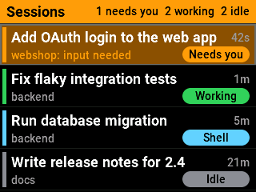
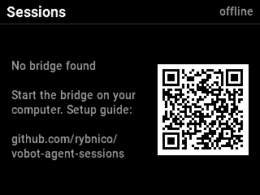

# Agent Sessions for Vobot Mini Dock

A [Vobot Mini Dock](https://dock.myvobot.com/) app that shows your running [Claude Code](https://claude.com/claude-code) sessions with their title, project, status and whether they are waiting for your answer. When a session needs you, the header turns into an orange banner, the session's row pulses, the ambient light turns orange and the screen wakes up.



## How it works

```text
~/.claude/sessions/<pid>.json ───► bridge on your computer ──HTTP──► Agent Sessions app
~/.claude/projects/*/<id>.jsonl ─┘ (port 8765, UDP discovery)        on the Mini Dock
```

- Claude Code keeps a live registry of its running sessions in `~/.claude/sessions/`. The **bridge** (`bridge/agent_sessions_bridge.py`) reads it, drops sessions whose process has exited, looks up each session's title in its transcript, and serves the result as JSON. It needs only Python 3 and its standard library.
- The **app** (`agent_sessions/`) finds the bridge on your network by itself and polls it every few seconds.

Nothing leaves your network: the app talks only to the bridge, and the bridge only reads local files.

## Device UI

| Status | Pill | Meaning |
|---|---|---|
| `waiting` | orange `Needs you` | Claude is blocked on you: a question, permission prompt or dialog |
| `busy` | green `Working` | Claude is working on a turn, including running tools |
| `shell` | blue `Shell` | The turn has ended but a background shell command is still running |
| `idle` | grey `Idle` | Waiting for your next prompt |

- Sessions that need you come first, then working ones, then idle ones. Each row shows the title, the project folder, and the time since the status last changed.
- Turn the encoder to move the selection. The selected row scrolls a title that is too long. When a session starts waiting, the selection jumps to it. ESC leaves the app.
- While a session needs you, the app keeps the screen awake and wakes it if it has gone to sleep (for example during the night schedule).

## Setup

### 1. Run the bridge on your computer

The bridge runs on the computer where you use Claude Code (macOS or Linux, Python 3.8 or newer):

```sh
git clone https://github.com/rybnico/vobot-agent-sessions.git
cd vobot-agent-sessions
bridge/install-service.sh          # start now and at every login (launchd on macOS, systemd on Linux)
```

Or run it in the foreground with `python3 bridge/agent_sessions_bridge.py`. `bridge/install-service.sh --uninstall` removes the service.

If your firewall asks, allow incoming connections for Python. The bridge listens on TCP and UDP port 8765.

### 2. Install the app on the Mini Dock

Find **Agent Sessions** in the [Vobot App Gallery](https://app.myvobot.com/) and note its App ID. On the device, open Settings → Application Settings, open `http://<device-address>/apps` in a browser, enter the App ID and click "Download and Install".

Open the app on the device. It finds the bridge automatically within a few seconds. If it shows "No bridge found", see [Troubleshooting](#troubleshooting).

### Bridge options

| Option | Effect |
|---|---|
| `--port 8765` | HTTP and UDP discovery port |
| `--claude-dir DIR` | Claude Code config directory to read (repeatable, globs allowed; default `$CLAUDE_CONFIG_DIR` or `~/.claude`) |
| `--token SECRET` | Require this token from the app (or set `AGENT_SESSIONS_TOKEN`) |
| `--no-discovery` | Don't answer the app's discovery broadcasts; set the bridge URL in the app instead |
| `--demo` | Serve made-up sessions, to try the app without Claude Code |
| `--once` | Print what the app would receive, then exit |
| `-v` | Log every request |

Options given to `install-service.sh` are passed to the bridge, e.g. `bridge/install-service.sh --token s3cret`.

### App settings

On the device's web page under Application Settings → Agent Sessions:

| Setting | Default | Effect |
|---|---|---|
| Bridge URL | empty (automatic) | Set it, e.g. `http://192.168.1.10:8765`, if discovery doesn't work on your network |
| Token | empty | Must match the bridge's `--token` |
| Refresh interval | 3 seconds | How often the app asks the bridge |
| Keep the screen awake | on | Keeps the screen on, and wakes it, while a session needs you |
| Ambient light | on | Orange ambient light while a session needs you |
| Beep | off | Short beep when a session starts waiting |

## Troubleshooting



- **"No bridge found"**: check that the bridge is running (`python3 bridge/agent_sessions_bridge.py --once` prints your sessions) and that your firewall allows UDP and TCP port 8765. Some networks (guest Wi-Fi, mesh systems with client isolation) block broadcasts; set the bridge URL in the app settings instead.
- **"The bridge wants a token"**: the bridge was started with `--token`; enter the same token in the app settings.
- **A session is missing**: only sessions of the user running the bridge are shown. If Claude Code uses another config directory, pass it with `--claude-dir`.

## Limitations

- The session registry (`~/.claude/sessions/*.json`) and the transcript title entries are Claude Code internals, not a documented interface; tested with Claude Code 2.1.309. A Claude Code update may change them.
- Keeping the screen awake and waking it uses undocumented Mini Dock firmware functions (tested with firmware 1.2.6). If a firmware update changes them, the app stops waking the screen; everything else keeps working.
- Alerts work only while the app is open on the device. It can take part in the device's automatic app switching.
- Without `--token`, anyone on your network can read your session titles and project names from the bridge.

## Development

- `./deploy.sh <device-address>` zips `agent_sessions/` and installs it through the device's app manager, without USB or Thonny. The device accepts uploads only while Settings → Application Settings is open on it, and usually reboots when you leave that mode after an install.
- Bump `version` in `agent_sessions/manifest.yml` for every release. The App Gallery package (`.vbt`) is built from `agent_sessions/` with Vobot's [Dock App Bundler](https://dock.myvobot.com/developer/guides/publishing-guide/); see [docs/app-gallery.md](docs/app-gallery.md) for the listing and release steps.
- See [AGENTS.md](AGENTS.md) for firmware details learned while building the app.

## License

[MIT](LICENSE). Not affiliated with or endorsed by Anthropic or Vobot. Claude and Claude Code are trademarks of Anthropic.
